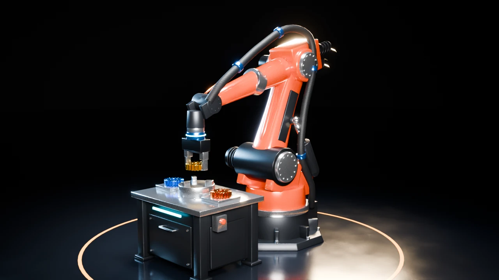

[简体中文](README.md) · **English**

# Blender 3D Studio

> **Turn DeepSeek Harness into a full Blender 3D production studio: zero-window Headless Cycles GPU rendering, workflow recording & cross-project recipe replay, single-launch multi-shot packs, a pure-JS PBR GLB Mesh Viewer v3, atomic multi-hunk script patching, and optional loopback Live Bridge direct controls.**

[](https://www.npmjs.com/package/dsh-blender-studio)
[](https://github.com/STARDUSTLC666/dsh-blender-studio/actions/workflows/ci.yml)
[](https://www.blender.org/download/)
[](https://github.com/STARDUSTLC666/dsh-blender-studio/blob/main/LICENSE)
[](https://www.npmjs.com/package/dsh-blender-studio)
[](https://www.npmjs.com/package/dsh-blender-studio)

**[What's New in v0.6.0](#whats-new-in-v060) · [3-Track Architecture](#3-track-architecture) · [Pro Exemplars](#built-in-pro-exemplar-showcase) · [Features](#features) · [Tools & Skills](#7-agent-tools--9-portable-skills) · [Install & Quickstart](#install) · [Security](#before-you-start) · [Full Reference](https://github.com/STARDUSTLC666/dsh-blender-studio/blob/main/docs/REFERENCE.en.md)**

<picture>
  <source media="(prefers-color-scheme: dark)" srcset="https://raw.githubusercontent.com/STARDUSTLC666/dsh-blender-studio/main/docs/assets/intro/workflow-en-dark.svg">
  
</picture>

## Why `dsh-blender-studio`?

Writing AI-driven `bpy` scripts blind usually hits the same walls: **no visual feedback loop, resending 50 KB scripts to tweak one parameter, Blender 3.6/4.x/5.x API breakages, no way to record and replay a winning studio pipeline across projects, exported GLBs cluttered with studio backdrops, or no safe way to tweak an open Blender scene live**.

`dsh-blender-studio` brings the **OP-DSH 3D Studio Workbench**, **7 structured Agent tools (including Workflow Recording & Replay)**, **9 portable Blender 3.6–5.x skills**, the **24-helper `DSH_KIT` v2 Hard-Surface & Cinema PBR Library**, and **8 starter templates + 5 real-rendered `QC-3D 100/A` Pro Engineering Exemplars** directly into DeepSeek Harness—covering blockout, clay QC, multi-angle photography, atomic script patching, reusable workflow recipes, Cycles GPU beauty rendering, and clean 3D delivery.

### What's New in v0.6.0

- **3D Workflow Recording, Reusable Recipe Library & One-Click Replay (`blender_workflow` + Workbench Workflow Tab)**: Automatically records template/exemplar setup, Lookdev tweaks, `patch_script`, renders/exports, and Live Bridge direct controls into a project timeline; ships 4 bilingual AAA recipes (including 100% non-destructive `clay-silhouette-audit`), one-click save-from-history, portable JSON copy/download/import, Dry-Run preview, non-destructive temporary `overrides` (`accentColor`/`lensMm`/`exposure`/`clayMode`/`qualityTier`/`exportFormat`), mandatory static safety enforcement on replay, and synchronous `wait: true`.
- **Live DeepSeek Harness & Blender 5.3 Battle-Tested Upgrades**: `toLosslessJson()` sanitizes all 7 tools against DSH host `INVALID_TOOL_OUTPUT` errors; product-scale auto-framing removes oversized distance floors and adds scale-aware `dsh_setup_hero_studio(scale=...)` for real metric products (15–30 cm headphones, cameras, watches); automatic Cycles GPU→CPU crash fallback under `computeDevice: 'auto'`; Python tracebacks remap `run.py` lines back to `customScript`; adds `blender_project(get_exemplar)`, line-numbered/regex `blender_script(read)`, `qualityTier` on `preview_still`/`contact_sheet`, and `read_image` visual QC alignment.
- **PBR-Aware Pure-JS `.glb` 3D Mesh Viewer v3 (Translucent Glass & Closed-Solid Backface Culling)**: Zero-dependency Canvas rasterizer with glTF metallic/roughness/emissive lighting, `alphaMode: "BLEND"` & `KHR_materials_transmission` translucent sapphire-crystal/glass layering, divergence-theorem closed-solid backface culling, oversized cap subdivision, cofactor normal transforms, and `ResizeObserver` redraw.
- **Blender 3.6–5.x Engine Quality & Live Bridge (`0.5.1`) Direct Controls**: OPTIX-safe studio clay override, EEVEE 4.2+/5.x raytracing & noise-free glass, 360° seamless cyclorama, modifier-baked backdrop-stripped 3D exports (`export_apply=True`, Lookdev-preserving `.blend`), built-in `numpy` 2×2 contact sheet stitching, atomic multi-hunk `patch_script` (≤50 hunks), and Live Bridge deep linked-node shader repainting + Quaternion-safe 3-axis object transforms.

## 3-Track Architecture

Render immediately without opening Blender—or connect live to a desktop Blender window whenever you want:

| Track | Mechanism | Best For |
| :--- | :--- | :--- |
| **Track A · Headless CLI (Default)** | Isolated `--background --factory-startup` execution of local Blender 3.6–5.x with automatic Cycles GPU (`OPTIX`/`CUDA`/`METAL`/`HIP`/`ONEAPI`) | Zero-window PNG stills, 2×2 4-View QC, single-launch `render_shots`, MP4 animation, clean GLB/FBX/OBJ/STL/`.blend` exports, 4-stage `pipeline` & `QC-3D` |
| **Track B · Live Socket Bridge (Optional)** | 1-click install of `dsh_blender_bridge.py` (`0.5.1`), bound strictly to `127.0.0.1:9876` with optional shared token | Live scene sync, Undo-safe (`Ctrl+Z`) direct camera, Quaternion-safe 3-axis object transform, deep PBR material repainting, and OpenGL viewport capture |
| **Track C · Open in Blender GUI** | Materializes compressed `.blend` and launches desktop Blender detached | Manual sculpting, precision topology, or interactive lookdev handoff |

## Built-In Pro Exemplar Showcase

All **five mechanical engineering & horology masterpieces** below **ship directly inside `dsh-blender-studio`** (launchable in 1 click from the Workbench Library or via `blender_project(action: 'create_from_exemplar')` and readable as few-shot `bpy` references; every exemplar responds live to `accentColor`, `lensMm`, `exposure`, and `clayMode` without code edits). Verified end-to-end on **Blender 5.3.0 Cycles + OpenImageDenoise + AgX** at **`QC-3D 100/A`** with zero issues:

| **CHRONO-X1 Skeleton Tourbillon Watch (34 objs · 42.1K polys · 64 spp Cycles OPTIX · Live Repaintable)** |
| :---: |
|  |

| AERO-X900 Cutaway Turbofan (37 objs · 64 spp Cycles) | KUKA 6-Axis Robot Arm Workstation (42 objs · 64 spp OPTIX) |
| :---: | :---: |
|  |  |
| **APEX-09 Cyber GT Hypercar (81 objs · 96 spp Cycles)** | **VANGUARD H-145X Twin-Turbine Helicopter (43 objs · 64 spp Cycles)** |
|  |  |

<details>
<summary>See OP-DSH 3D Studio workbench screenshots (Interactive Stage, 1-Click Pipeline, QC-3D Outliner & 4-View Check)</summary>


Captured in a local DeepSeek Harness environment with live Blender 5.3.0 Cycles & EEVEE renders.

</details>

## Features

| Pillar | Capabilities |
| :--- | :--- |
| **OP-DSH 3D Studio, GLB Viewer v3 & Shot Filmstrip** | Zero-dependency Canvas 3D stage (8 template silhouettes, live `lensMm` 18–135 mm / `exposure` -3..+3 EV / `clayMode` preview, shortcuts `Space`/`1–6`/`R`/`Ctrl+S`), **pure-JS PBR `.glb` 3D Mesh Viewer v3** (metallic/roughness/emissive/translucent-glass 3-light shading, closed-solid backface culling, cofactor normals, `TRIANGLE_STRIP`/`TRIANGLE_FAN`, material-aware decimation, `Shaded`/`Shaded + Wire`/`Clay`/`Wireframe`, pan, PNG Snapshot, auto-focus on export & uploaded `.glb` preview), **Multi-Shot Filmstrip**, aspect-matched **A/B Render Compare**, and direct Shot/GLB inspect jumps |
| **Engine Quality, Multi-Shot Pack & `DSH_KIT` v2** | **`render_shots` Single-Launch Multi-Camera Batch** (1–5 presets in one launch, monotonic per-sample & per-shot progress, 20-artifact retention); **Cycles GPU auto-acceleration** (`OPTIX`/`CUDA`/`METAL`/`HIP`/`ONEAPI` with safe `CPU` fallback) + **OPTIX-safe clay override** + **EEVEE 4.2+/5.x raytracing & noise-free glass** + **Blender 5.x FFmpeg MP4**; **24 cross-version `dsh_*` helpers**, built-in `numpy` 2×2 contact sheet stitching, modifier-baked backdrop-stripped 3D exports (`export_apply=True`, Lookdev-preserving `.blend`), evaluated depsgraph polycounts, and 4-stage **`pipeline`** |
| **Atomic Patching, `wait: true` & Live Bridge (`0.5.1`)** | **Atomic multi-hunk `patch_script`** (single `find`/`replace` or batched `edits[]` up to 50 hunks with pre-write safety check, rollback on failure & 10 auto-checkpoints); synchronous **`wait: true`** on `inspect_scene`, `blender_render`, and `run_headless`; **1-click installer** for `dsh_blender_bridge.py` (`0.5.1`) with Undo-safe camera framing, **Quaternion-safe 3-axis Live Object Transform UI**, and **deep linked-node PBR material introspection & repainting** (including Metallic slider & LED emission detection) |
| **Workflow Recording & Replay, 7 Tools, 9 Skills & Safety** | **3D Workflow Recording, Reusable Recipe Library, Portable JSON Import/Export & One-Click Replay** (4 built-in AAA recipes + live timeline + non-destructive overrides); 8 starter templates + 5 live-repaintable `QC-3D 100/A` Pro Exemplars; drag-and-drop auto-wired HDRIs & 3D models; 7 Agent tools + 9 open-format skills; `256 KB` custom scripts, 13 `NodeSocket`-safe static checks, UUID optimistic locking, opt-in allowlisted Poly Haven CC0 client, and 13 bright themes × 8 dual-layer fonts |

## 7 Agent Tools & 9 Portable Skills

| Agent Tool | Capabilities |
| :--- | :--- |
| **`blender_health`** | Read-only diagnostics: local Blender `3.6–5.x` path/version, Cycles GPU backend (`OPTIX`/`CUDA`/`METAL`/`HIP`/`ONEAPI`), Live Bridge connectivity, and 9-skill registration health |
| **`blender_project`** | Project CRUD, read-only Pro Exemplar inspection (`get_exemplar`) & 1-click launch of all 5 Pro Exemplars, Live Lookdev overrides (`accentColor`/`lensMm`/`exposure`/`clayMode`), script checkpoints, and `inspect_scene` (`wait: true`) |
| **`blender_render`** | `preview_still`, `contact_sheet`, `render_shots`, and 4-stage `pipeline` (supporting `qualityTier`), plus `render_animation` and `export_model` (all 6 async actions support synchronous `wait: true` returning artifact paths & `QC-3D`) |
| **`blender_script`** | Line-numbered/regex `read`, 13-rule static safety scanner, single or atomic multi-hunk `patch` (`edits[]` up to 50), `run_headless` (`wait: true`), and `run_bridge` |
| **`blender_bridge`** | 1-click `install_addon` (`0.5.1`), `sync_project`, `scene_info`, `viewport_capture`, Undo-safe direct controls (`set_camera`/`transform_object`/`set_material`, pass project `id` to record into workflow history), and `open_gui` |
| **`blender_assets`** | Project asset management plus opt-in, host-allowlisted Poly Haven CC0 HDRI/texture/model search & import |
| **`blender_workflow`** | Live recording toggle, project action `history`, distill recipes (`save_from_history`), custom `create`, portable JSON `export`/`import`, and cross-project `replay` with `dryRun`, non-destructive `overrides`, and `wait: true` |

> **9 Portable Open-Format Skills (`skills/blender-*/SKILL.md`)**: `blender-production-pipeline` · `blender-scene-architecture` · `blender-bpy-scripting` · `blender-materials-lighting` · `blender-geometry-nodes` · `blender-camera-animation` · `blender-rendering-export` · `blender-grease-pencil` · `blender-visual-qc` (copy directly into Claude Code, Cursor, Gemini CLI, or OpenAI Codex).

## Install

Open **Plugins** in the DSH desktop app and install `dsh-blender-studio`, or use the CLI:

```bash
dsh plugin --profile desktop add dsh-blender-studio
```

For the web profile, replace `desktop` with `web` and restart DSH. Requires DSH `>=0.2.2-rc.3` and Node `^22.19.0 || >=24.0.0`.

## Start Using It

1. **Verify local Blender & Cycles GPU**: Open **Blender 3D** in the sidebar and check **Bridge & Env** to confirm auto-detected Blender `3.6–5.x` and GPU acceleration (`OPTIX` / `CUDA` / `METAL` / `HIP` / `ONEAPI`, switchable between `Auto` / `GPU` / `CPU`).
2. **Start from Templates, 5 Pro Exemplars, or `DSH_KIT` v2**: Pick any of the 8 starter templates or launch one of the **5 Pro Exemplars** in 1 click from the Library, then dial `accentColor`, `lensMm` (18–135 mm), `exposure` (-3..+3 EV), and `clayMode` live—reflected immediately on the interactive stage.
3. **Drag-and-drop auto-wired assets & inspect PBR `.glb`**: Drop local HDRIs (`.hdr`/`.exr` auto-light the World), textures, or 3D models (`.glb`/`.obj`/`.fbx`/`.stl` auto-normalize & ground on stage) in **Assets & Exports**. Exported or uploaded `.glb` files open in **3D Mesh v3** with PBR shading, wireframe overlay, pan, and PNG Snapshot.
4. **Multi-Shot Lookdev Pack, `QC-3D` & A/B Compare**: Run **Multi-Shot Pack (`render_shots`)** to capture up to 5 editorial angles in one launch, or run **Pipeline** for chained `QC-3D` + 4-View QC + Cycles GPU render + backdrop-stripped GLB export, then browse the **Shot Filmstrip** and wipe revisions in **A/B Compare**.
5. **1-Click Live Bridge (`0.5.1`) Direct Controls**: Click **Install Add-on to Blender** in **Bridge & Env**, start the server in Blender (`N → DSH Bridge → Start DSH Bridge`), then sync scenes (with Lookdev overrides) and drive live Undo-safe camera framing, Quaternion-safe 3-axis object transforms, and deep linked-node PBR material repainting from **Direct Controls** or `blender_bridge`. See [Live Bridge Guide](https://github.com/STARDUSTLC666/dsh-blender-studio/blob/main/docs/BRIDGE.md).
6. **Record, Save & Replay 3D Workflows**: Open the **Workflow** tab to inspect the automatically recorded action timeline, distill winning lookdev/multi-shot/export steps into reusable named recipes or portable JSON, and replay them across projects with Dry-Run preview and temporary non-destructive `overrides` (or invoke `blender_workflow` directly from DeepSeek).

### Example Prompts

> Create a project from the built-in `chronograph-tourbillon-watch` exemplar, repaint `accentColor` to `#E11D48`, set `lensMm` to `85` and `exposure` to `0.3`, and run `blender_render(action: 'render_shots', shots: ['hero_3q', 'macro_dof', 'low_dramatic', 'top_plan'], qualityTier: 'studio', wait: true)` to capture a 4-shot lookdev pack synchronously in one launch.

> Run `blender_workflow(action: 'replay', workflowId: 'clay-silhouette-audit', id: '<projectId>', wait: true)` for a non-destructive clay silhouette & 4-view audit, then distill the successful sequence from project history into a reusable recipe and replay it on a new colorway.

> Apply an atomic multi-hunk `blender_script(action: 'patch', edits: [{ find: 'roughness=0.28', replace: 'roughness=0.14' }, { find: 'lens_mm=50', replace: 'lens_mm=65' }], note: 'Polish highlights and lens')`, then run `blender_render(action: 'pipeline', qualityTier: 'beauty', exportFormat: 'glb', wait: true)` for a denoised Cycles GPU beauty render and clean GLB export.

> Sync this project into my open Blender window via `blender_bridge`, frame an 85mm shallow-DoF closeup with `set_camera`, repaint the hero metallic shader with `set_material`, and capture the viewport.

## Before You Start

- **Local Blender required**: The plugin does not bundle the Blender binary. Install [Blender 3.6–5.x](https://www.blender.org/download/) locally; if it is outside your default `PATH`, set `DSH_BLENDER_EXECUTABLE` or configure the path in **Bridge & Env**.
- **Safe defaults**: Custom `bpy` scripts and atomic multi-hunk `patch_script` updates pass 13 static safety rules before writing or running (blocking shell calls, destructive deletion, network sockets, and path traversal without false-positiving on Blender `NodeSocket` code). Poly Haven CC0 downloads are opt-in and host-allowlisted; Live Bridge binds exclusively to `127.0.0.1` with `auto_start` off by default.
- **Portable skills**: All 9 bundled skills in `skills/` use the open Agent Skills (`SKILL.md`) format and can be copied into Claude Code, Cursor, Gemini CLI, or OpenAI Codex.

## Plugin Updates

Check updates at the bottom of the workbench or native plugin details. Automatic checks are on by default; **automatic installation is off**, and installs pause whenever render jobs are running or unsaved drafts exist. Suite-managed components update with their bundle.

## Documentation & Feedback

- [Full Reference (Tools, HTTP API & `DSH_KIT` v2)](https://github.com/STARDUSTLC666/dsh-blender-studio/blob/main/docs/REFERENCE.en.md) · [Live Bridge Protocol & Direct Controls](https://github.com/STARDUSTLC666/dsh-blender-studio/blob/main/docs/BRIDGE.md) · [Changelog](https://github.com/STARDUSTLC666/dsh-blender-studio/blob/main/CHANGELOG.md) · [Validation Matrix](https://github.com/STARDUSTLC666/dsh-blender-studio/blob/main/docs/VALIDATION.md)
- Stars, [Issues](https://github.com/STARDUSTLC666/dsh-blender-studio/issues), and [PRs](https://github.com/STARDUSTLC666/dsh-blender-studio/pulls) are welcome (include plugin + Blender versions and strip tokens/secrets first).

## License

[MIT](https://github.com/STARDUSTLC666/dsh-blender-studio/blob/main/LICENSE)
