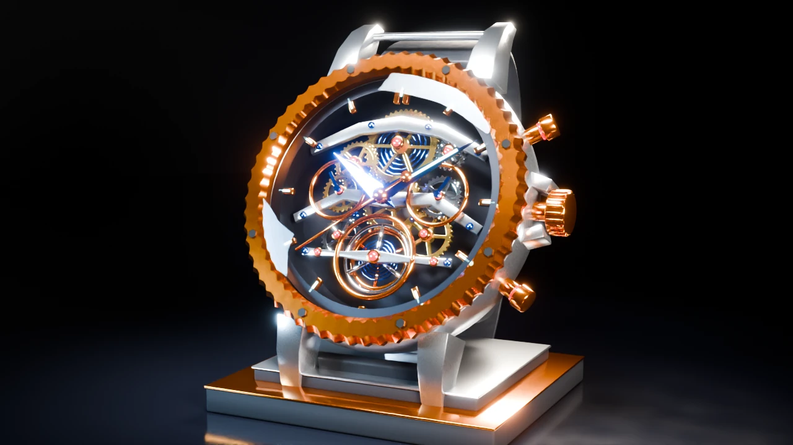
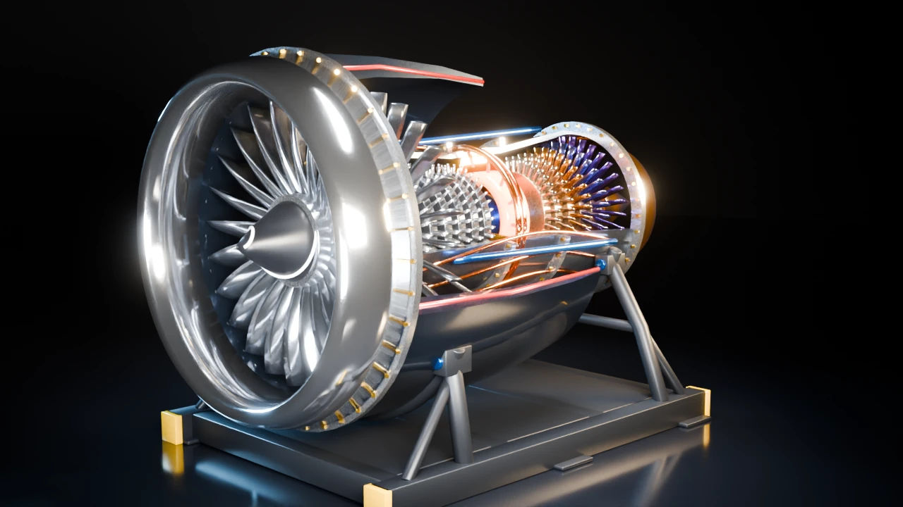
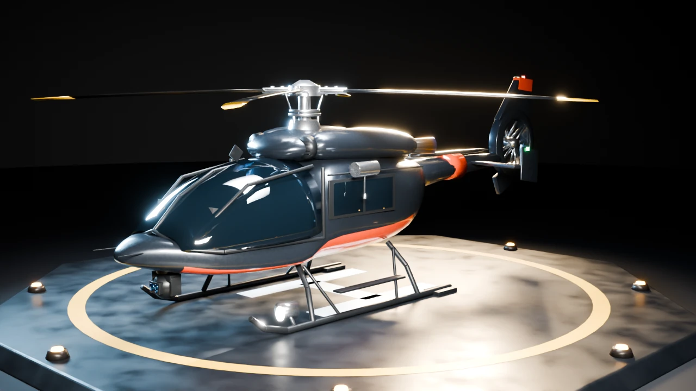
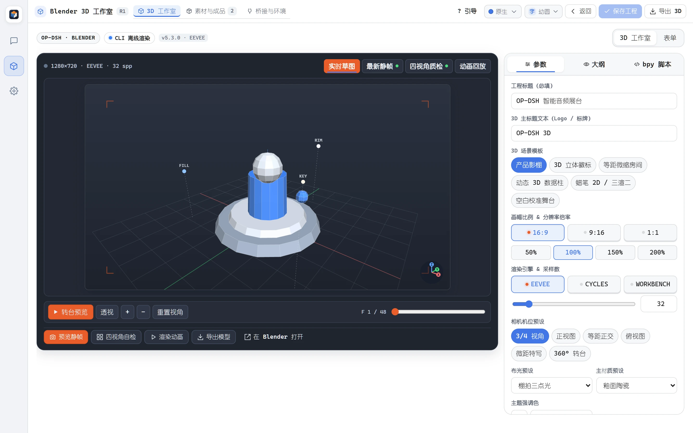
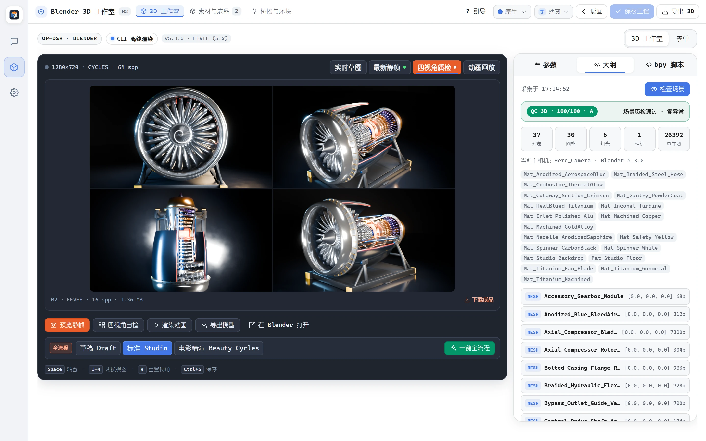

[简体中文](README.md) · **English**

# Blender 3D Studio

> **Build precision 3D assemblies, batch-render multi-camera lookdev packs in one launch, tune live lookdev overrides, inspect GLBs in 3-light Phong, direct live Blender scenes over Bridge v2, and render with Cycles GPU inside DeepSeek Harness.**

Ships with the **OP-DSH 3D Studio Workbench** (featuring **zero-dependency `.glb` 3D Mesh Viewer v2**, **Multi-Shot Filmstrip**, **Live Lookdev overrides**, and **A/B Render Compare**), **Headless Blender CLI with Cycles GPU auto-acceleration & single-launch `render_shots`**, the **24-helper `DSH_KIT` v2 Hard-Surface & Cinema PBR Library**, **5 live-repaintable Pro Engineering Exemplars + 8 starter templates**, **Live Bridge v2 direct controls & 1-click installer**, and 9 Blender 3.6–5.x skills.

[](https://www.npmjs.com/package/dsh-blender-studio) [](https://www.npmjs.com/package/dsh-blender-studio) [](https://www.npmjs.com/package/dsh-blender-studio)

**[Features](#features) · [Built-In Pro Exemplars](#built-in-pro-exemplar-showcase) · [Install](#install) · [Workflow](#start-using-it) · [Full Reference](https://github.com/STARDUSTLC666/dsh-blender-studio/blob/main/docs/REFERENCE.en.md) · [Live Bridge Guide](https://github.com/STARDUSTLC666/dsh-blender-studio/blob/main/docs/BRIDGE.md)**

<picture>
  <source media="(prefers-color-scheme: dark)" srcset="https://raw.githubusercontent.com/STARDUSTLC666/dsh-blender-studio/main/docs/assets/intro/workflow-en-dark.svg">
  
</picture>

## Built-In Pro Exemplar Showcase

All **five mechanical engineering & horology masterpieces** below **ship directly inside `dsh-blender-studio` v0.4.0** (launchable in 1 click from the Workbench Library or via `blender_project(action: 'create_from_exemplar')` and readable as few-shot `bpy` references; every exemplar responds live to `accentColor`, `lensMm`, `exposure`, and `clayMode` without code edits). Verified end-to-end on **Blender 5.3.0 Cycles + OpenImageDenoise + AgX** at **`QC-3D 100/A`** with zero issues:

| **NEW · CHRONO-X1 Skeleton Tourbillon Watch (34 objs · 13.1K polys · 64 spp Cycles OPTIX · Live Repaintable)** |
| :---: |
|  |

| AERO-X900 Cutaway Turbofan (37 objs · 64 spp Cycles) | KUKA 6-Axis Robot Arm Workstation (42 objs · 64 spp OPTIX) |
| :---: | :---: |
|  |  |
| **APEX-09 Cyber GT Hypercar (81 objs · 96 spp Cycles)** | **VANGUARD H-145X Twin-Turbine Helicopter (43 objs · 64 spp Cycles)** |
|  |  |

<details>
<summary>See OP-DSH 3D Studio workbench screenshots (Interactive Stage, 1-Click Pipeline, QC-3D Outliner & 4-View Check)</summary>





Captured in a local DeepSeek Harness environment with live Blender 5.3.0 Cycles & EEVEE renders.

</details>

## Features

| Pillar | Capabilities |
| :--- | :--- |
| **OP-DSH 3D Studio, GLB Viewer v2 & Shot Filmstrip** | Zero-dependency Canvas 3D stage (8 template silhouettes, shortcuts `Space`/`1–4`/`R`/`Ctrl+S`, **Live Lookdev controls** for `lensMm` 18–135 mm, `exposure` -3..+3 EV & `clayMode`), **pure-JS `.glb` 3D Mesh Viewer v2** (3-light studio Phong shading, `Shaded` / `Shaded + Wire` / `Clay` / `Wireframe`, `Shift+Drag` & right-click pan, 1-click PNG Snapshot, plus previewing uploaded `.glb` assets), clickable **Multi-Shot Filmstrip**, and **A/B Render Compare** across `still` / `contact_sheet` / `shot` |
| **Single-Launch Multi-Shot Pack, 24-Helper `DSH_KIT` v2 & Patch** | **`render_shots` Multi-Camera Batch**: builds the scene once in a single Blender launch and renders 1–5 editorial camera presets (`hero_3q` / `low_dramatic` / `macro_dof` / `side_profile` / `top_plan`, artifact retention raised to `20`); **24 cross-version `dsh_*` helpers**, **surgical `patch_script`** (pre-write safety scan + 10 auto-checkpoints), and **1-click 4-stage `pipeline`** (`Draft` / `Studio` / `Beauty Cycles`) |
| **Cycles GPU Auto-Acceleration & Live Bridge v2 Direct Controls** | **Track A (Default)**: Auto-detects local Blender 3.6–5.x and **Cycles GPU backends (`OPTIX`/`CUDA`/`METAL`/`HIP`/`ONEAPI` with safe `CPU` fallback)** via `computeDevice`, plus drag-and-drop auto-wired HDRIs & GLB/OBJ/FBX/STL models; **Track B (Optional)**: **1-click installer** for loopback-only `dsh_blender_bridge.py` (`0.4.0`), adding Undo-safe structured direct controls (**`set_camera` / `transform_object` / `set_material`**) from both the Workbench and Agent tools; **Track C**: 1-click open `.blend` in desktop Blender |
| **8 Templates + 5 Exemplars, 6 Tools, 9 Skills & Safety** | 8 starter templates + **5 live-repaintable `QC-3D 100/A` Pro Engineering Exemplars**, 6 Agent tools, 9 open-format skills, `256 KB` custom scripts, 13 `NodeSocket`-safe static checks, UUID optimistic locking, opt-in allowlisted Poly Haven CC0 client, and 13 bright themes × 8 dual-layer fonts |

## Install

Open **Plugins** in the DSH desktop app and install `dsh-blender-studio`, or use the CLI:

```bash
dsh plugin --profile desktop add dsh-blender-studio
```

For the web profile, replace `desktop` with `web` and restart DSH. Requires DSH `>=0.2.2-rc.3` and Node `^22.19.0 || >=24.0.0`.

## Start using it

1. **Verify local Blender & Cycles GPU**: Open **Blender 3D** in the sidebar and check **Bridge & Env** to confirm auto-detected Blender `3.6–5.x` and GPU acceleration (`OPTIX` / `CUDA` / `METAL` / `HIP` / `ONEAPI`, toggleable between `Auto` / `GPU` / `CPU`).
2. **Start from Templates, 5 Pro Exemplars, or `DSH_KIT` v2**: Pick any of the 8 starter templates or launch one of the **5 Pro Exemplars** in 1 click from the Library, then dial `accentColor`, `lensMm` (18–135 mm), `exposure` (-3..+3 EV), and `clayMode` live without touching Python.
3. **Drag-and-drop auto-wired assets & inspect `.glb`**: Drop local HDRIs (`.hdr`/`.exr` auto-light the World), textures, or 3D models (`.glb`/`.obj`/`.fbx`/`.stl` auto-normalize & ground on stage) in **Assets & Exports**. Inspect both exported and uploaded `.glb` meshes in **3D Mesh v2** with 3-light Phong, wireframe overlay, pan, and PNG Snapshot.
4. **Multi-Shot Lookdev Pack, `QC-3D` & A/B Compare**: Run **Multi-Shot Pack (`render_shots`)** to render `hero_3q`, `low_dramatic`, `macro_dof`, `side_profile`, and `top_plan` in one Blender launch, browse frames on the **Shot Filmstrip**, wipe revisions in **A/B Compare**, or run **Pipeline** for chained `QC-3D` + 4-View QC + Cycles GPU render + GLB export.
5. **1-Click Live Bridge v2 Direct Controls**: Click **Install Add-on to Blender** in **Bridge & Env** (`dsh_blender_bridge.py` v0.4.0), start the server in Blender (`N → DSH Bridge`), then sync scenes and drive live Undo-safe camera framing, object transforms, and PBR material repainting from the Workbench **Direct Controls** or `blender_bridge`. See [Live Bridge Guide](docs/BRIDGE.md).

### Example prompts

> Create a project from the built-in `chronograph-tourbillon-watch` exemplar, repaint `accentColor` to `#E11D48` (crimson rose gold), set `lensMm` to `85` and `exposure` to `0.3`, and run `blender_render(action: 'render_shots', shots: ['hero_3q', 'macro_dof', 'low_dramatic', 'top_plan'], qualityTier: 'studio')` to render a 4-shot lookdev pack in one launch.

> Follow `blender-production-pipeline` using `DSH_KIT` v2 to build a concept gas turbine. Enable `clayMode: true` for a 2×2 clay QC sheet first, confirm `QC-3D 100/A`, then disable `clayMode` and run `pipeline` (`qualityTier: 'beauty'`) with Cycles GPU to render the beauty still and export GLB.

> Sync this project into my open Blender window via `blender_bridge`, frame an 85mm shallow-DoF closeup with `set_camera`, repaint the hero chassis metallic cobalt with `set_material`, and capture the viewport.

## Before you start

- **Local Blender required**: The plugin does not bundle the Blender binary. Install [Blender 3.6–5.x](https://www.blender.org/download/) locally; if it is outside your default `PATH`, set `DSH_BLENDER_EXECUTABLE` or configure the path in **Bridge & Env**.
- **Safe defaults**: Custom `bpy` scripts and surgical `patch_script` updates pass 13 static safety rules before writing or running (blocking shell calls, destructive deletion, network sockets, and path traversal without false-positiving on Blender `NodeSocket` code). Poly Haven CC0 downloads are opt-in and host-allowlisted; Live Bridge binds exclusively to `127.0.0.1` with `auto_start` off by default.
- **Portable skills**: All 9 bundled skills in `skills/` use the open Agent Skills (`SKILL.md`) format and can be copied into Claude Code, Cursor, Gemini CLI, or OpenAI Codex.

## Plugin updates

Check updates at the bottom of the workbench or native plugin details. Automatic checks are on by default; **automatic installation is off**, and installs pause whenever render jobs are running or unsaved drafts exist. Suite-managed components update with their bundle.

## Documentation & feedback

- [Full Reference (Tools, HTTP API & `DSH_KIT` v2)](https://github.com/STARDUSTLC666/dsh-blender-studio/blob/main/docs/REFERENCE.en.md) · [Live Bridge v2 Protocol & Direct Controls](https://github.com/STARDUSTLC666/dsh-blender-studio/blob/main/docs/BRIDGE.md) · [Changelog](https://github.com/STARDUSTLC666/dsh-blender-studio/blob/main/CHANGELOG.md) · [Validation Matrix](https://github.com/STARDUSTLC666/dsh-blender-studio/blob/main/docs/VALIDATION.md)
- Stars, [Issues](https://github.com/STARDUSTLC666/dsh-blender-studio/issues), and [PRs](https://github.com/STARDUSTLC666/dsh-blender-studio/pulls) are welcome (include plugin + Blender versions and strip tokens/secrets first).

## License

[MIT](https://github.com/STARDUSTLC666/dsh-blender-studio/blob/main/LICENSE)
