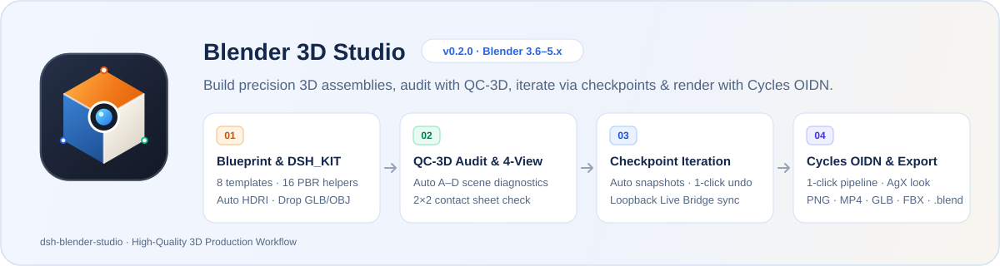

[简体中文](README.md) · **English**

# Blender 3D Studio

> **Build precision 3D assemblies, preview interactively, auto-audit with QC-3D, iterate with script checkpoints, and render Cycles OIDN stills, MP4s & GLB/FBX/OBJ/STL assets inside DeepSeek Harness.**

Ships with the **OP-DSH 3D Studio Interactive Workbench**, **Headless Blender CLI Runner**, **16-helper `DSH_KIT` Hard-Surface & Cinema PBR Library**, **1-Click Production `pipeline`**, **Loopback-Only Live Socket Bridge**, 8 cross-version `bpy` templates, and 9 specialized Blender 3.6–5.x skills.

[](https://www.npmjs.com/package/dsh-blender-studio) [](https://www.npmjs.com/package/dsh-blender-studio) [](https://www.npmjs.com/package/dsh-blender-studio)

**[Features](#features) · [Showcase](#live-render-showcase) · [Install](#install) · [Workflow](#start-using-it) · [Full Reference](https://github.com/STARDUSTLC666/dsh-blender-studio/blob/main/docs/REFERENCE.en.md) · [Live Bridge Guide](https://github.com/STARDUSTLC666/dsh-blender-studio/blob/main/docs/BRIDGE.md)**

<picture>
  <source media="(prefers-color-scheme: dark)" srcset="https://raw.githubusercontent.com/STARDUSTLC666/dsh-blender-studio/main/docs/assets/intro/workflow-en-dark.svg">
  
</picture>

## Live Render Showcase

All three mechanical engineering scenes below were authored, checkpointed, audited (`QC-3D 100/A`, zero issues), and rendered end-to-end through **`dsh-blender-studio` v0.2.0** (`BlenderWorkbench` + `DSH_KIT` Fog Glow compositor + `action: 'pipeline'`) on local **Blender 5.3.0 Cycles + OpenImageDenoise + AgX**:


| APEX-09 Cyber GT Hypercar (81 objects · 96 spp Cycles) | VANGUARD H-145X Twin-Turbine Helicopter (43 objects · 64 spp Cycles) |
| :---: | :---: |
|  |  |

<details>
<summary>See OP-DSH 3D Studio v0.2.0 workbench screenshots (Interactive Stage, 1-Click Pipeline, QC-3D Outliner & 4-View Check)</summary>


Captured in a local DeepSeek Harness environment with live Blender 5.3.0 Cycles & EEVEE renders.

</details>

## Features

| Pillar | Capabilities |
| :--- | :--- |
| **AAA 3D Production Pipeline** | Built-in **16-helper `DSH_KIT` library** (hard-surface bevels, radial arrays, swept tubes, assembly grounding/framing, 7 cinema PBR shaders, 4 studio rigs & cross-version `FOG_GLOW` compositor), **1-click `pipeline`** (`Draft` / `Studio` / `Beauty Cycles` chaining `QC-3D` → 4-view QC → render → GLB), and automatic **Script Checkpoints** with 1-click rollback |
| **OP-DSH 3D Studio** | Zero-dependency interactive Canvas 3D stage (8 template silhouettes, orbit drag, zoom, shortcuts `Space`/`1–4`/`R`/`Ctrl+S`, Quality Presets), seamless switching to PNG stills / **2×2 4-View QC sheets** / MP4 playback, live **`QC-3D` grade badge** in Outliner & `DSH_KIT` quick-insert bar; 1-click toggle to classic **Form** |
| **Hybrid Engine & Auto-Wired Assets** | **Track A (Default)**: Zero-window Headless CLI (`blender --background --factory-startup`) for Blender 3.6–5.x with Cycles OIDN + AgX; drag-and-drop HDRIs auto-light the World and GLB/OBJ/FBX/STL models auto-ground on stage; **Track B (Optional)**: loopback-only `dsh_blender_bridge.py` (`127.0.0.1`) with live `QC-3D`; **Track C**: 1-click open `.blend` in desktop Blender |
| **8 Templates, 9 Skills & Safety** | Built-in `product-studio`, `logo-3d`, `isometric-room`, `motion-data`, `grease-pencil-2d`, `blank-stage`, `architectural-pavilion`, and `procedural-abstract` (native `GeometryNodeTree`) plus 9 domain skills; `256 KB` custom scripts, 13 `NodeSocket`-safe static checks, UUID optimistic locking, opt-in allowlisted Poly Haven CC0 client, and 13 bright themes × 8 dual-layer fonts |

## Install

Open **Plugins** in the DSH desktop app and install `dsh-blender-studio`, or use the CLI:

```bash
dsh plugin --profile desktop add dsh-blender-studio
```

For the web profile, replace `desktop` with `web` and restart DSH. Requires DSH `>=0.2.2-rc.3` and Node `^22.19.0 || >=24.0.0`.

## Start using it

1. **Verify local Blender**: Open **Blender 3D** in the sidebar and check **Bridge & Env** to confirm auto-detected Blender `3.6–5.x` (or set `DSH_BLENDER_EXECUTABLE`).
2. **Stage from templates or `DSH_KIT`**: Create a project to enter **OP-DSH 3D Studio** (switch to **Form** anytime in 1 click). Choose among 8 cross-version templates or switch to custom `bpy` scripting powered by built-in `dsh_*` engineering/PBR helpers; use **Duplicate** to branch lookdev experiments safely.
3. **Drag-and-drop auto-wired assets**: Drop local HDRIs (`.hdr`/`.exr` auto-light the scene), textures, or 3D models (`.glb`/`.obj`/`.fbx`/`.stl` auto-normalize & ground onto the pedestal) in **Assets & Exports**, or optionally enable Poly Haven CC0 discovery.
4. **Audit with `QC-3D`, checkpoint & run `pipeline`**: Trigger **Run Pipeline** (`Draft` / `Studio` / `Beauty Cycles`) or run `QC-3D` Outliner inspection + **2×2 Contact Sheet** checks. Script edits auto-snapshot so you can roll back in 1 click, then export Cycles OIDN PNG stills, MP4 videos, `GLB` / `FBX` / `OBJ` / `STL` / `.blend`, and Store-mode source ZIP archives.
5. **Optional Live Bridge**: Download `dsh_blender_bridge.py` from **Bridge & Env** and enable it in Blender to sync scenes live, pull live `QC-3D`, capture viewports, or execute `bpy` with Undo history. See [Live Bridge Guide](docs/BRIDGE.md).

### Example prompts

> Follow `blender-production-pipeline` to build a cutaway high-bypass turbofan jet engine using `DSH_KIT` radial blades, swept copper fuel pipes, and brushed titanium shaders. Save a checkpoint, verify `QC-3D` Grade A + 2×2 contact sheet, then run `pipeline` (`qualityTier: 'beauty'`) to render a 1280×720 Cycles OIDN still and export GLB.

> Create an `architectural-pavilion` scene, attach my uploaded HDRI for automatic world lighting, check the 4-view sheet in Draft, then render a studio hero still.

> Build a `procedural-abstract` Geometry Nodes twisted sculpture with a 72-frame 360° turntable animation, export MP4, and sync it into my open Blender window via Live Bridge.

## Before you start

- **Local Blender required**: The plugin does not bundle the Blender binary. Install [Blender 3.6–5.x](https://www.blender.org/download/) locally; if it is outside your default `PATH`, set `DSH_BLENDER_EXECUTABLE` or configure the path in **Bridge & Env**.
- **Safe defaults**: Custom `bpy` scripts pass 13 static safety rules before execution (blocking shell calls, destructive deletion, network sockets, and path traversal without false-positiving on Blender `NodeSocket` code). Poly Haven CC0 downloads are disabled by default and restricted to official HTTPS hosts when enabled.
- **Portable skills**: All 9 bundled skills in `skills/` use the open Agent Skills (`SKILL.md`) format and can be copied into Claude Code, Cursor, Gemini CLI, or OpenAI Codex.

## Plugin updates

Check updates at the bottom of the workbench or native plugin details. Automatic checks are on by default; **automatic installation is off**, and installs pause whenever render jobs are running or unsaved drafts exist. Suite-managed components update with their bundle.

## Documentation & feedback

- [Full Reference (Tools, HTTP API & `DSH_KIT`)](https://github.com/STARDUSTLC666/dsh-blender-studio/blob/main/docs/REFERENCE.en.md) · [Live Bridge Protocol & Troubleshooting](https://github.com/STARDUSTLC666/dsh-blender-studio/blob/main/docs/BRIDGE.md) · [Changelog](https://github.com/STARDUSTLC666/dsh-blender-studio/blob/main/CHANGELOG.md) · [Validation Matrix](https://github.com/STARDUSTLC666/dsh-blender-studio/blob/main/docs/VALIDATION.md)
- Stars, [Issues](https://github.com/STARDUSTLC666/dsh-blender-studio/issues), and [PRs](https://github.com/STARDUSTLC666/dsh-blender-studio/pulls) are welcome (include plugin + Blender versions and strip tokens/secrets first).

## License

[MIT](https://github.com/STARDUSTLC666/dsh-blender-studio/blob/main/LICENSE)
