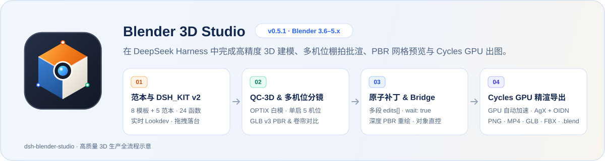
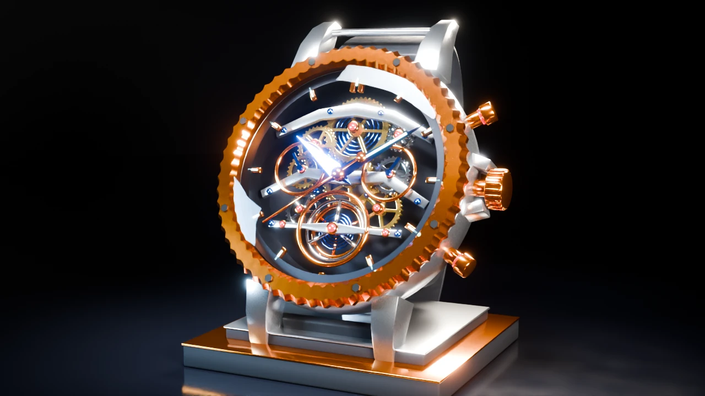
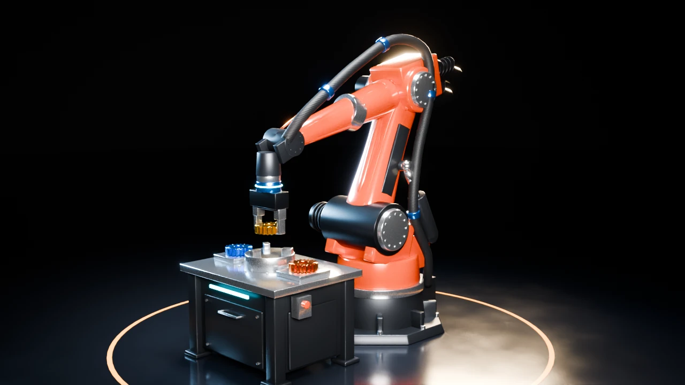
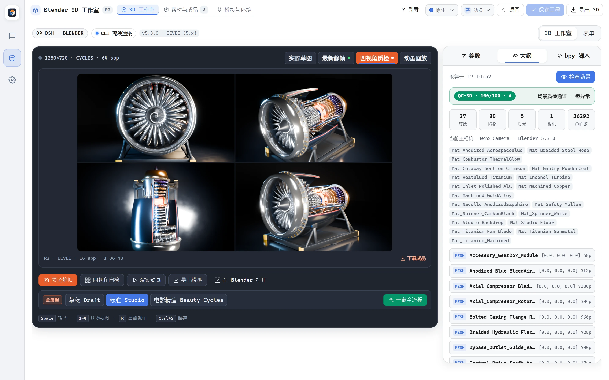

**简体中文** · [English](README.en.md)

# Blender 3D Studio

> **把 DeepSeek Harness 变成完整的 Blender 3D 生产工作台：零窗口 Headless Cycles GPU 渲染、单启多机位摄影包、PBR 交互式 GLB 网格视口 v3、原子多段脚本补丁与可选本地回环 Live Bridge 直控。**

[](https://www.npmjs.com/package/dsh-blender-studio)
[](https://github.com/STARDUSTLC666/dsh-blender-studio/actions/workflows/ci.yml)
[](https://www.blender.org/download/)
[](https://github.com/STARDUSTLC666/dsh-blender-studio/blob/main/LICENSE)
[](https://www.npmjs.com/package/dsh-blender-studio)
[](https://www.npmjs.com/package/dsh-blender-studio)

**[v0.5.1 亮点](#v051-核心升级) · [三轨架构](#三轨工作流架构) · [范本画廊](#内置高阶范本画廊) · [核心能力](#核心能力) · [工具与技能](#6-个智能体工具与-9-个开放技能) · [安装与上手](#安装) · [安全边界](#开始前要知道) · [完整参考](https://github.com/STARDUSTLC666/dsh-blender-studio/blob/main/docs/REFERENCE.zh.md)**

<picture>
  <source media="(prefers-color-scheme: dark)" srcset="https://raw.githubusercontent.com/STARDUSTLC666/dsh-blender-studio/main/docs/assets/intro/workflow-zh-dark.svg">
  
</picture>

## 为什么选择 `dsh-blender-studio`？

用 AI 写 `bpy` 代码最常见的痛点是：**看不见几何体、改一行重发几万 Token、Blender 3.6/4.x/5.x API 报错、导出模型带影棚背景、或者想实时改机位/材质却无从下手**。

`dsh-blender-studio` 为 DeepSeek Harness 提供开箱即用的 **OP-DSH 3D 工作室**、**6 个结构化智能体工具**、**9 个跨平台 Blender 3.6–5.x 技能**、**24 项 `DSH_KIT` v2 建模与 PBR 函数库**、**8 套工程模板 + 5 套实渲验证 `QC-3D 100/A` 高阶机械范本**，覆盖从起稿、白模体检、多机位棚拍、原子补丁迭代到 Cycles GPU 精渲与 3D 交付的全流程。

### v0.5.1 核心升级

- **PBR 交互式 `.glb` 网格视口 v3（支持透明玻璃与闭体背面剔除）**：纯 JS 零依赖 Canvas 软光栅升级，支持 glTF 金属度/粗糙度/自发光着色、`alphaMode: "BLEND"` 与 `KHR_materials_transmission` 半透明蓝宝石表镜/玻璃罩透视分层渲染、散度定理闭体背面剔除与大三角自动细分（消除底座堆叠穿插）、余子式法线矩阵、`TRIANGLE_STRIP`/`TRIANGLE_FAN`、材质边界感知减面与 `ResizeObserver` 响应式缩放；导出 GLB 后自动聚焦 3D 网格视图，实时舞台同步响应 `lensMm` 与 `exposure` EV。
- **Blender 3.6–5.x 引擎级画质与稳定升级**：Cycles **OPTIX/CUDA/CPU 安全白模覆写**（彻底规避 OPTIX AO 卡死）、EEVEE 4.2+/5.x 光追与无噪点半透明玻璃、360° 无缝环形影棚、透明底自动隐藏背景、Blender 5.x FFmpeg `media_type` 适配、导出自动烘焙修改器（`export_apply=True`）并剥离影棚背景（`.blend` 导出完整保留 Lookdev 覆写与打包压缩）、零依赖内置 `numpy` 高速 2×2 四视角拼图、Depsgraph 真实面数统计与 Geometry Nodes 零误报。
- **AI 代理工作流大幅提速**：支持**原子多段 `patch_script`（`edits[]` 单次最多 50 处修改，失败整批回滚且仅留 1 份快照）**与 **`wait: true` 同步等待模式**（`inspect_scene` / `blender_render` / `run_headless` 一调即得成品路径、`QC-3D` 报告与完整失败错误诊断）；修正单帧/多机位/四视角实时采样进度映射；`bridge_sync` 与源码备份 ZIP 完整同步 Lookdev 覆写。
- **Live Bridge (`0.5.1`) 深度材质重绘与全旋转模式对象变换直控**：跨越 `ColorRamp` / `Mix` / `Checker` / `HueSat` / 活跃 `Emission` / `Roughness MapRange` 节点链精准回读并重绘材质（含 LED 发光主色自动识别与未传 `roughness` 时准确回读链表粗糙度），原生兼容 `QUATERNION` / `AXIS_ANGLE` / 欧拉旋转模式（glTF 导入模型无缝直控），工作台新增**实时金属度滑块**与**3 轴实时对象变换（XYZ + 旋转）**直控面板。

## 三轨工作流架构

无需打开 Blender 窗口即可立刻出图，也支持随时切入桌面 Blender 实时联动：

| 运行轨道 | 工作机制 | 适用场景 |
| :--- | :--- | :--- |
| **Track A · Headless CLI（默认开箱即用）** | 隔离无头启动本机 Blender 3.6–5.x（`--background --factory-startup`，自动调度 Cycles GPU `OPTIX`/`CUDA`/`METAL`/`HIP`/`ONEAPI`） | 静帧 PNG、2×2 四视角质检、单启多机位 `render_shots`、MP4 动画、GLB/FBX/OBJ/STL/`.blend` 导出、一键 4 阶段 `pipeline` 与 `QC-3D` 体检 |
| **Track B · Live Socket Bridge（可选直控）** | 一键安装 `dsh_blender_bridge.py` (`0.5.1`)，仅绑定本机回环 `127.0.0.1:9876`（支持共享 Token） | 实时同步工程到桌面 Blender、免代码直控相机 / 全旋转模式 3 轴对象变换 / 深度 PBR 材质重绘（全操作支持 `Ctrl+Z` 撤销）与视口抓图 |
| **Track C · Open in Blender GUI（桌面接力）** | 一键物化压缩 `.blend` 并在本机桌面 Blender 打开 | 需要手工雕刻、精细拓扑或复杂材质节点微调时无缝接力 |

## 内置高阶范本画廊

以下 **5 套复杂机械与精密制表作品**全部**直接内置于插件中**（工程库 1 键「从此范本创建」或 `blender_project(action: 'create_from_exemplar')` 启动，并可供 AI 读取作 Few-Shot `bpy` 范例；全系支持零改码实时 `accentColor` 换色、`lensMm` 焦段、`exposure` 曝光与 `clayMode` 白模覆写），均通过本机 **Blender 5.3.0 Cycles + OpenImageDenoise + AgX** 实渲验证并达到 **`QC-3D 100/A`** 零缺陷：

| **CHRONO-X1 镂空陀飞轮机械腕表（34 对象 · 42.1K 面 · 64 spp Cycles OPTIX · 实时换色）** |
| :---: |
|  |

| AERO-X900 剖视涡扇航发（37 对象 · 64 spp Cycles） | KUKA 6 轴工业机械臂工作站（42 对象 · 64 spp OPTIX） |
| :---: | :---: |
|  |  |
| **APEX-09 赛博 GT 超跑（81 对象 · 96 spp Cycles）** | **VANGUARD H-145X 双发救援直升机（43 对象 · 64 spp Cycles）** |
|  |  |

<details>
<summary>查看 OP-DSH 3D 工作室实景截图（交互视口、一键全流程、QC-3D 大纲与四视角质检）</summary>




图片来自本地 DeepSeek Harness 验证环境与本机 Blender 5.3.0 Cycles / EEVEE 实渲输出。

</details>

## 核心能力

| 模块 | 核心特性 |
| :--- | :--- |
| **OP-DSH 3D 工作室、GLB 视口 v3 与分镜对比** | 零外部依赖 Canvas 3D 舞台（8 套模板轮廓、实时响应 `lensMm` 18–135mm / `exposure` -3..+3 EV / `clayMode` 白模、快捷键 `Space`/`1–6`/`R`/`Ctrl+S`）、**`.glb` 3D 网格查看器 v3**（PBR 金属/粗糙/自发光/玻璃透射三光源着色、闭体背面剔除、余子式法线矩阵、`TRIANGLE_STRIP`/`TRIANGLE_FAN`、材质边界感知减面、4 种视图模式、平移缩放、PNG 快照、导出自动聚焦及素材直览）、**多机位分镜底片条**、**A/B 卷帘对比**（适配工程画幅）与素材页分镜筛选/一键跳转 |
| **引擎画质、单启多机位批渲与 `DSH_KIT` v2** | **`render_shots` 单进程多机位摄影包**（单启出齐 1–5 组摄影机位，单调精准采样进度，成品保留上限 20 份）；**Cycles GPU 自动加速**（`OPTIX`/`CUDA`/`METAL`/`HIP`/`ONEAPI`，安全回退 CPU）+ **OPTIX 安全白模** + **EEVEE 4.2+/5.x 光追与无噪点玻璃** + **Blender 5.x FFmpeg MP4**；**24 项 `DSH_KIT` v2 建模与 PBR 函数**、**`numpy` 2×2 四视角质检**、**`export_apply=True` 去背景洁净 3D 导出**（`.blend` 保留 Lookdev 覆写）、Depsgraph 真实面数统计与 4 阶段 **`pipeline`** |
| **AI 精准迭代与 Live Bridge (`0.5.1`) 直控** | **原子多段 `patch_script`**（支持单处 `find`/`replace` 或批量 `edits[]` 最多 50 处修改、写前安全扫描、失败整批回滚、自动留存 10 份脚本快照）；**`wait: true` 同步等待模式**（`inspect_scene` / `blender_render` / `run_headless` 一调返回成品与 `QC-3D`）；**一键安装 `dsh_blender_bridge.py` (`0.5.1`)**，支持 Undo 安全的机位、**全旋转模式 3 轴对象变换**与**深度节点链材质（含金属度/粗糙度/自发光）**实时回读重绘 |
| **8 模板 + 5 范本、6 工具、9 技能与安全边界** | 8 套跨版本模板（含 360° 无缝影棚、建筑展馆与 Geometry Nodes 程序化雕塑）+ 5 套实渲 `QC-3D 100/A` 范本；拖放 HDRI/3D 模型自动装配；6 个智能体工具 + 9 个开放格式技能；`256 KB` 脚本上限、13 条 `NodeSocket` 友好静态安全校验、UUID 乐观锁、默认关闭的白名单 Poly Haven CC0 客户端与 DSH v3 13 套主题 × 8 套字体 |

## 6 个智能体工具与 9 个开放技能

| 智能体工具 | 核心职责 |
| :--- | :--- |
| **`blender_health`** | 只读自检：Blender 3.6–5.x 路径/版本、Cycles GPU 后端（OPTIX/CUDA/METAL/HIP/ONEAPI）、Live Bridge 状态、9 技能注册健康度 |
| **`blender_project`** | 工程 CRUD、5 套高阶范本一键创建、实时 Lookdev 覆写（`accentColor`/`lensMm`/`exposure`/`clayMode`）、快照回滚与 `inspect_scene`（支持 `wait: true`） |
| **`blender_render`** | `preview_still`、`contact_sheet`、`render_shots`、`render_animation`、`export_model`、`pipeline`（均支持 `wait: true` 同步等待直出成品路径与 `QC-3D`） |
| **`blender_script`** | 13 条规则静态安全扫描、`patch` 单处或原子多段 `edits[]`（≤50 处）、`run_headless`（支持 `wait: true`）与 `run_bridge` |
| **`blender_bridge`** | 一键安装 `dsh_blender_bridge.py` (`0.5.1`)、实时同步工程、`scene_info`、`viewport_capture`、Undo 安全直控（`set_camera`/`transform_object`/`set_material`）与 `open_gui` |
| **`blender_assets`** | 工程素材管理，以及默认关闭、严格白名单限域的 Poly Haven CC0 HDRI/贴图/模型检索导入 |

> **9 个跨平台开放技能（`skills/blender-*/SKILL.md`）**：`blender-production-pipeline` · `blender-scene-architecture` · `blender-bpy-scripting` · `blender-materials-lighting` · `blender-geometry-nodes` · `blender-camera-animation` · `blender-rendering-export` · `blender-grease-pencil` · `blender-visual-qc`（可直接复制到 Claude Code / Cursor / Gemini CLI / Codex 复用）。

## 安装

在 DSH 桌面版「插件」面板搜索安装 `dsh-blender-studio`，或使用命令行：

```bash
dsh plugin --profile desktop add dsh-blender-studio
```

网页版将 `desktop` 改为 `web`，安装后重启 DSH。宿主要求：`>=0.2.2-rc.3`（Node `^22.19.0 || >=24.0.0`）。

## 快速上手

1. **检查本机 Blender 与 GPU 加速**：从左侧栏打开 **Blender 3D**，进入「桥接与环境」页确认已自动探测到本机 Blender `3.6–5.x` 及 Cycles GPU 后端（如 `OPTIX` / `CUDA` / `METAL`，可按需切换 `自动 / 优先 GPU / 仅 CPU`）。
2. **从模板、5 套高阶范本或 `DSH_KIT` v2 起稿**：在工程库挑选 8 套模板或 **5 套高阶范本**（一键「从此范本创建」），顶部 Lookdev 控制条可零代码实时切换 `accentColor`、`lensMm`、`exposure` 与 `clayMode`（且实时反映在 3D 舞台中）。
3. **拖放素材自动装配与 PBR 3D 检视**：在「素材与成品」页拖放本地 HDRI（`.hdr`/`.exr` 自动打光）、贴图或 3D 模型（`.glb`/`.obj`/`.fbx`/`.stl` 自动归一化落台）；导出或上传的 `.glb` 均可一键跳转至舞台 **3D 网格 v3** 进行 PBR 旋转检视并导出 PNG 快照。
4. **单启多机位摄影包、`QC-3D` 与 A/B 对比**：运行 **`render_shots` 多机位分镜包** 一次启动批量输出 5 套专业机位，或在「一键全流程（Pipeline）」串联 `QC-3D` 体检、2×2 四视角质检、Cycles GPU 精渲与自动去背景 GLB 导出，并在底片条与 A/B 卷帘中直接验收。
5. **一键安装并直控 Live Bridge (`0.5.1`)**：在「桥接与环境」页点击 **「一键安装到本机 Blender」**，在 Blender `N → DSH Bridge` 点击 **Start DSH Bridge** 后，即可同步工程（自动携带 Lookdev 覆写）并通过「实时直控」面板或 `blender_bridge` 实时调相机、改 3 轴对象位置/旋转与深度重绘 PBR 材质（支持 `Ctrl+Z` 撤销）；详见 [Live Bridge 指南](https://github.com/STARDUSTLC666/dsh-blender-studio/blob/main/docs/BRIDGE.md)。

### 常用对话示例

> 从内置范本 `chronograph-tourbillon-watch` 创建陀飞轮腕表工程，把 `accentColor` 改为 `#E11D48`、`lensMm` 设为 `85`、`exposure` 设为 `0.3`，调用 `blender_render(action: 'render_shots', shots: ['hero_3q', 'macro_dof', 'low_dramatic', 'top_plan'], qualityTier: 'studio', wait: true)` 同步一次出齐 4 机位摄影包。

> 用 `blender_script(action: 'patch', edits: [{ find: 'roughness=0.28', replace: 'roughness=0.14' }, { find: 'lens_mm=50', replace: 'lens_mm=65' }], note: '高光与焦段微调')` 原子修改当前脚本，再用 `blender_render(action: 'pipeline', qualityTier: 'beauty', exportFormat: 'glb', wait: true)` 完成 Cycles GPU 精渲与洁净 GLB 导出。

> 用 `blender_bridge` 把当前工程同步到打开的 Blender 窗口，先用 `set_camera` 推近到 85mm 景深特写，再用 `set_material` 重绘金属主色与粗糙度并截取视口图。

## 开始前要知道

- **本机依赖**：插件不自带 Blender 二进制，需本机已安装 [Blender 3.6–5.x](https://www.blender.org/download/)。若未加入系统 `PATH`，可在「桥接与环境」页手动配置路径或设置环境变量 `DSH_BLENDER_EXECUTABLE`。
- **默认安全策略**：自定义 `bpy` 脚本与原子多段 `patch_script` 写入前均经过 13 条静态安全扫描（拦截系统命令、破坏性删除、网络套接字与路径穿越，不误报 Blender `NodeSocket` 代码）；Poly Haven 外部资产检索默认关闭，开启后严格限制官方 HTTPS 主机白名单；Live Bridge 仅绑定 `127.0.0.1` 回环且自动启动默认关闭。
- **跨平台技能复用**：`skills/` 下 9 个技能采用开放 Agent Skills（`SKILL.md`）格式，可直接复制到 Claude Code、Cursor、Gemini CLI 或 OpenAI Codex 使用。

## 插件更新

在工作台或原生插件详情页底部检查更新。默认自动检查，**默认不自动安装**；有运行中渲染任务或未保存修改时自动暂停安装。Suite 管理的组件随整包更新。

## 文档与反馈

- [完整工具、HTTP API 与 `DSH_KIT` v2 参考](https://github.com/STARDUSTLC666/dsh-blender-studio/blob/main/docs/REFERENCE.zh.md) · [Live Bridge 协议与直控指南](https://github.com/STARDUSTLC666/dsh-blender-studio/blob/main/docs/BRIDGE.md) · [更新记录](https://github.com/STARDUSTLC666/dsh-blender-studio/blob/main/CHANGELOG.md) · [测试与验证矩阵](https://github.com/STARDUSTLC666/dsh-blender-studio/blob/main/docs/VALIDATION.md)
- 欢迎 Star、提交 [Issues](https://github.com/STARDUSTLC666/dsh-blender-studio/issues) 与 [PR](https://github.com/STARDUSTLC666/dsh-blender-studio/pulls)（反馈请附插件版本、Blender 版本与复现步骤，并移除令牌等敏感信息）。

## License

[MIT](https://github.com/STARDUSTLC666/dsh-blender-studio/blob/main/LICENSE)
