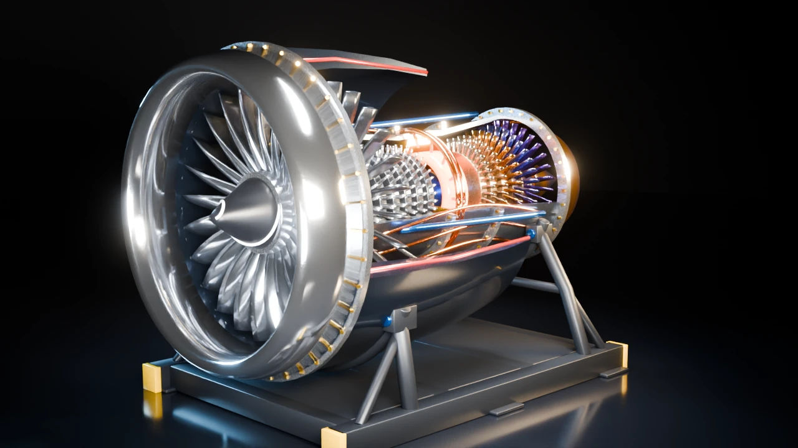

**简体中文** · [English](README.en.md)

# Blender 3D Studio

> **在 DeepSeek Harness 中完成高精度 3D 建模、实时预览、自动体检（QC-3D）、精准脚本补丁迭代与 Cycles GPU 电影级渲染导出。**

内置 **OP-DSH 3D 工作室**（含**零依赖纯 JS `.glb` 3D 网格查看器**与 **A/B 渲染对比卷帘**）、**Headless Blender CLI（Cycles GPU 自动加速）**、**24 项 `DSH_KIT` v2 硬表面与 PBR 辅助库**、**4 套高阶工程范本 + 8 套跨版本 `bpy` 模板**、**一键安装本地回环 Live Bridge** 与 9 个 Blender 3.6–5.x 专业技能。

[](https://www.npmjs.com/package/dsh-blender-studio) [](https://www.npmjs.com/package/dsh-blender-studio) [](https://www.npmjs.com/package/dsh-blender-studio)

**[核心能力](#核心能力) · [内置高阶范本画廊](#内置高阶范本画廊) · [安装](#安装) · [快速上手](#开始使用) · [完整说明](https://github.com/STARDUSTLC666/dsh-blender-studio/blob/main/docs/REFERENCE.zh.md) · [Live Bridge 指南](https://github.com/STARDUSTLC666/dsh-blender-studio/blob/main/docs/BRIDGE.md)**

<picture>
  <source media="(prefers-color-scheme: dark)" srcset="https://raw.githubusercontent.com/STARDUSTLC666/dsh-blender-studio/main/docs/assets/intro/workflow-zh-dark.svg">
  
</picture>

## 内置高阶范本画廊

以下 4 套复杂机械工程作品全部**内置于插件中**（工程库 1 键「从此范本创建」或 `blender_project(action: 'create_from_exemplar')` 启动，并可供 AI 读取作为 Few-Shot 脚本参考），均通过本机 **Blender 5.3.0 Cycles + OpenImageDenoise + AgX** 实渲验证并达到 **`QC-3D 100/A`** 零缺陷：

| AERO-X900 剖视涡扇航发（37 对象 · 64 spp Cycles） | KUKA 6 轴工业机械臂工作站（42 对象 · 64 spp Cycles OPTIX） |
| :---: | :---: |
|  |  |
| **APEX-09 赛博 GT 超跑（81 对象 · 96 spp Cycles）** | **VANGUARD H-145X 双发救援直升机（43 对象 · 64 spp Cycles）** |
|  |  |

<details>
<summary>查看 OP-DSH 3D 工作室实景截图（交互视口、一键全流程、QC-3D 大纲与四视角质检）</summary>


图片来自本地 DeepSeek Harness 验证环境与本机 Blender 5.3.0 Cycles / EEVEE 实渲输出。

</details>

## 核心能力

| 模块 | 核心特性 |
| :--- | :--- |
| **OP-DSH 3D 工作室与交互视口** | 零外部依赖 Canvas 3D 舞台（8 套模板轮廓、快捷键 `Space`/`1–4`/`R`/`Ctrl+S` 与一键画质预设）、**纯 JS `.glb` 3D 网格查看器**（着色 / 白模 / 线框三档切换）、**A/B 渲染对比卷帘**（指针拖拽与方向键对比多版本成品）、静帧 / **2×2 四视角质检** / MP4 回放、顶部 **`QC-3D` 评分徽章**大纲与 `DSH_KIT` v2 代码速插条；1 键切回经典「表单」 |
| **24 项 `DSH_KIT` v2、精准补丁与全流程** | 内置 **24 个跨版本 `dsh_*` 辅助函数**（放样壳体、螺栓环、轮毂总成、散热百叶、环形阵列、车漆/碳纤维/拉丝金属/阳极氧化铝/热蓝钛/铜金/深色玻璃/轮胎/LED/装甲 + 四套棚拍舞台 + 白模覆盖 + Fog Glow 泛光）、**精准局部补丁 `patch_script`**（不重发整段 40–256 KB 脚本、自动存快照）与**一键 4 阶段 `pipeline`**（`Draft` / `Studio` / `Beauty Cycles`） |
| **Cycles GPU 自动加速与一键 Bridge** | **Track A（默认）**：自动探测本机 Blender 3.6–5.x 与 **Cycles GPU 后端（`OPTIX`/`CUDA`/`METAL`/`HIP`/`ONEAPI`，安全回退 CPU）**，支持 `computeDevice`（`auto`/`gpu`/`cpu`）切换，拖放上传 HDRI 自动打光、拖放 GLB/OBJ/FBX/STL 自动落台；**Track B（可选）**：支持**一键向本机 Blender 自动安装启用 `dsh_blender_bridge.py`**（仅 `127.0.0.1` 回环，带实时 `QC-3D` 与 GPU 状态）；**Track C**：一键桌面 Blender 打开 `.blend` |
| **8 模板 + 4 工程范本、9 技能与安全边界** | 内置 8 套场景模板与 4 套 `QC-3D 100/A` 高阶工程范本、6 个工具与 9 个原生技能；支持 `256 KB` 自定义脚本、13 条 `NodeSocket` 友好静态安全校验、UUID 乐观锁、默认关闭的白名单 Poly Haven CC0 客户端与 DSH v3 的 13 套明亮主题 × 8 套双层字体 |

## 安装

在 DSH 桌面版「插件」面板安装 `dsh-blender-studio`，或使用命令行：

```bash
dsh plugin --profile desktop add dsh-blender-studio
```

网页版将 `desktop` 改为 `web`，安装后重启 DSH。宿主要求：`>=0.2.2-rc.3`（Node `^22.19.0 || >=24.0.0`）。

## 开始使用

1. **检查本机 Blender 与 GPU 加速**：从左侧栏打开 **Blender 3D**，进入「桥接与环境」页确认已自动探测到本机 Blender `3.6–5.x` 及 Cycles GPU 后端（如 `OPTIX` / `CUDA` / `METAL`，可按需切换 `自动 / 优先 GPU / 仅 CPU`）。
2. **从模板、高阶工程范本或 `DSH_KIT` v2 起稿**：在工程库挑选 8 套基础模板或 4 套 **高阶工程范本**（一键「从此范本创建」），或在 **OP-DSH 3D 工作室** 切换到 `bpy 脚本` 使用内置 24 项 `dsh_*` 函数与代码速插条。
3. **拖放素材自动装配**：在「素材与成品」页直接拖放本地 HDRI（`.hdr`/`.exr` 自动打光）、贴图或 3D 模型（`.glb`/`.obj`/`.fbx`/`.stl` 自动归一化落台）；也可显式开启 Poly Haven 检索 CC0 资产。
4. **`QC-3D` 体检、精准补丁、GLB 3D 检视与 A/B 对比**：运行 **一键全流程（Pipeline）** 自动完成 `QC-3D` 体检、2×2 四视角质检、Cycles 精渲与 GLB 导出；直接在视口切到 **`3D 网格`** 旋转检视导出的 `.glb`，或切到 **`A/B 对比`** 拖动卷帘比对前后版本；局部调参使用 `patch_script` 节省 Token 且自动留存快照随时 1 键回滚。
5. **一键安装 Live Bridge**：在「桥接与环境」页点击 **「一键安装到本机 Blender」**（确认后自动无头安装启用 `dsh_blender_bridge.py`），在 Blender `N → DSH Bridge` 启动即可实时同步工程、拉取实时 `QC-3D` 与视口抓图；详见 [Live Bridge 指南](docs/BRIDGE.md)。

### 常用对话示例

> 从内置范本 `kuka-6axis-robot-arm` 创建一个 6 轴机械臂工程，用 `blender_script(action: 'patch')` 把机械臂机身涂装改为钴蓝色金属漆并调亮顶部柔光灯，保存快照后运行 `pipeline` (`qualityTier: 'beauty'`) 用 Cycles GPU 精渲静帧并导出 GLB。

> 按 `blender-production-pipeline` 5 阶段流程用 `DSH_KIT` v2（`dsh_loft_profile`、`dsh_bolt_ring`、`dsh_mat_heat_blued_titanium`）建一台概念燃气轮机，先开 `dsh_render_clay_override(True)` 跑 2×2 四视角白模体检，再切回 PBR 材质精渲。

> 用 `blender_bridge(action: 'install_addon', confirmed: true)` 帮我把 Live Bridge 插件安装到本机 Blender，然后把当前工程同步到打开的 Blender 窗口。

## 开始前要知道

- **本机依赖**：插件不自带 Blender 二进制，需本机已安装 [Blender 3.6–5.x](https://www.blender.org/download/)。若未加入系统 `PATH`，可在「桥接与环境」页手动配置路径或设置 `DSH_BLENDER_EXECUTABLE`。
- **默认安全策略**：自定义 `bpy` 脚本与局部 `patch_script` 写入前均经过 13 条静态安全扫描（拦截系统命令、破坏性删除、网络套接字与目录穿越，不误报 Blender `NodeSocket` 代码）；Poly Haven 外部资产检索默认关闭，开启后严格限制官方 HTTPS 主机白名单；Live Bridge 仅绑定 `127.0.0.1` 回环且自动启动默认关闭。
- **跨平台技能复用**：`skills/` 下 9 个技能采用开放 Agent Skills（`SKILL.md`）格式，可复制到 Claude Code、Cursor、Gemini CLI 或 OpenAI Codex 直接使用。

## 插件更新

在工作台或原生插件详情页底部检查更新。默认自动检查，**默认不自动安装**；有运行中渲染任务或未保存修改时自动暂停安装。Suite 管理的组件随整包更新。

## 文档与反馈

- [完整工具、API 与 `DSH_KIT` v2 参考](https://github.com/STARDUSTLC666/dsh-blender-studio/blob/main/docs/REFERENCE.zh.md) · [Live Bridge 协议与一键安装](https://github.com/STARDUSTLC666/dsh-blender-studio/blob/main/docs/BRIDGE.md) · [更新记录](https://github.com/STARDUSTLC666/dsh-blender-studio/blob/main/CHANGELOG.md) · [测试与验证说明](https://github.com/STARDUSTLC666/dsh-blender-studio/blob/main/docs/VALIDATION.md)
- 欢迎 Star、提交 [Issues](https://github.com/STARDUSTLC666/dsh-blender-studio/issues) 与 [PR](https://github.com/STARDUSTLC666/dsh-blender-studio/pulls)（反馈请附插件版本、Blender 版本与复现步骤，并移除令牌等敏感信息）。

## License

[MIT](https://github.com/STARDUSTLC666/dsh-blender-studio/blob/main/LICENSE)
