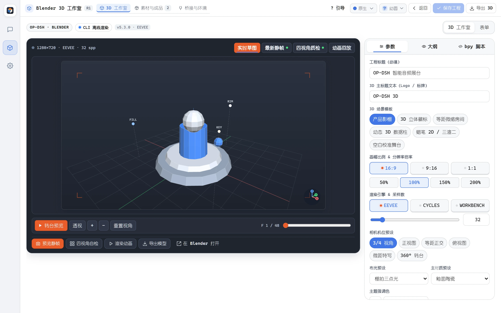
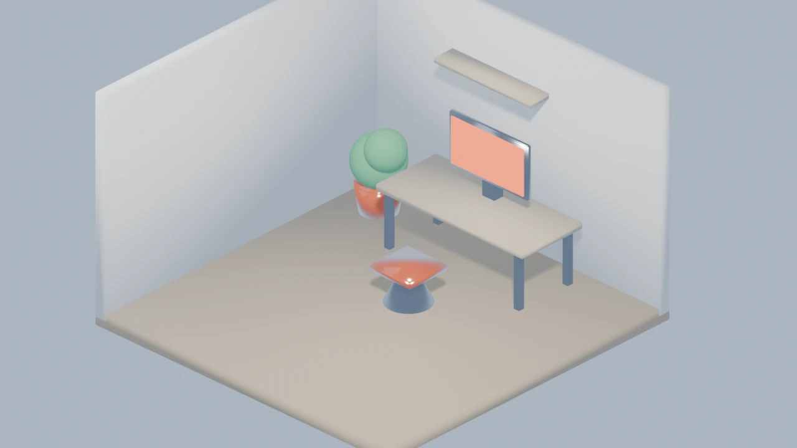
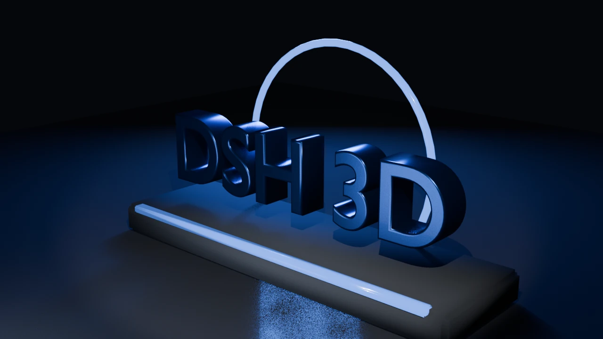
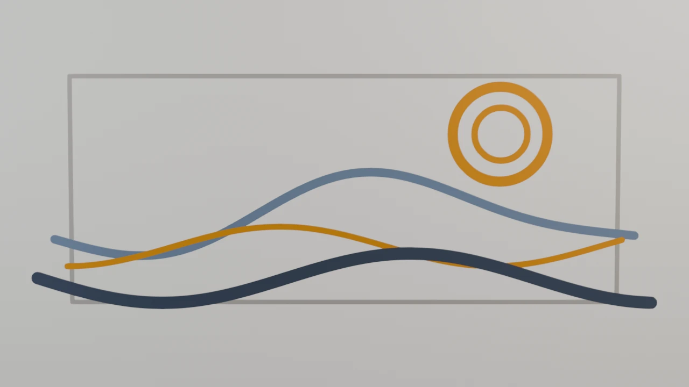

**简体中文** · [English](README.en.md)

# Blender 3D Studio

> **在 DeepSeek Harness 中用 Blender 创作、实时预览、四视角质检并导出 3D 模型、静帧与高清 MP4 动画。**

内置 **OP-DSH 3D 工作室交互预览工作台**、**Headless Blender CLI 无头渲染引擎**、**本地回环 Live Bridge 插件**、6 套跨版本 `bpy` 工程模板与 8 个 Blender 3.6–5.x 专业技能。

[](https://www.npmjs.com/package/dsh-blender-studio) [](https://www.npmjs.com/package/dsh-blender-studio) [](https://www.npmjs.com/package/dsh-blender-studio)

**[核心能力](#核心能力) · [安装](#安装) · [快速上手](#开始使用) · [完整说明](https://github.com/STARDUSTLC666/dsh-blender-studio/blob/main/docs/REFERENCE.zh.md) · [Live Bridge 指南](https://github.com/STARDUSTLC666/dsh-blender-studio/blob/main/docs/BRIDGE.md)**

## 核心能力

| 模块 | 核心特性 |
| :--- | :--- |
| **OP-DSH 3D 工作室** | 零外部依赖 Canvas 3D 实时预览舞台（轨道拖拽、缩放、三轴指示、6 套模板线框/面片与 Turntable 预演），无缝切换静帧 PNG / **2×2 四视角质检图** / MP4 回放与场景大纲、`bpy` 脚本检查器；1 键切回经典「表单」 |
| **双轨驱动架构** | **Track A（默认）**：无需打开 Blender 窗口，自动探测本机 Blender 3.6–5.x 执行无头 CLI 渲染与导出；**Track B（可选）**：内置单文件 `dsh_blender_bridge.py` 仅监听 `127.0.0.1` 回环实时联动；**Track C**：一键在桌面 Blender GUI 中打开工程 `.blend` |
| **6 套模板与 8 项专业技能** | 内置 `product-studio` / `logo-3d` / `isometric-room` / `motion-data` / `grease-pencil-2d` / `blank-stage` 模板与 8 个原生技能，自动适配 `BLENDER_EEVEE_NEXT`、Principled BSDF 4.0+、AgX 与 GPv3，并支持 AI 四视角视觉自检闭环 |
| **安全边界与统一外观** | 13 条静态 `bpy` 脚本安全校验、UUID 乐观锁存储、默认关闭的白名单 Poly Haven CC0 资产检索；适配 DSH `>=0.2.2-rc.3`，内置 13 套明亮风格主题与 8 套中英双层字体（默认幼圆等宽），跨插件实时同步 |

<details>
<summary>查看工作台实景截图与 Blender 实渲示例</summary>

#### OP-DSH 3D 工作室（实时草图视口 & 2×2 四视角质检 + 场景大纲）




#### 内置模板真实 Blender 无头渲染成品

| 等距微缩房间 (`isometric-room`) | 3D 立体徽标 (`logo-3d`) |
| :---: | :---: |
|  |  |
| **动态 3D 数据柱 (`motion-data`)** | **蜡笔 2D / 三渲二 (`grease-pencil-2d`)** |
|  |  |

图片来自本地 DeepSeek Harness 验证环境与本机 Blender 5.3.0 无头 CLI 实渲输出，使用内置示例模板。

</details>

## 安装

在 DSH 桌面版「插件」面板安装 `dsh-blender-studio`，或使用命令行：

```bash
dsh plugin --profile desktop add dsh-blender-studio
```

网页版将 `desktop` 改为 `web`，安装后重启 DSH。宿主要求：`>=0.2.2-rc.3`（Node `^22.19.0 || >=24.0.0`）。

## 开始使用

1. **检查本机 Blender**：从左侧栏打开 **Blender 3D**，进入「桥接与环境」页确认已自动探测到本机 Blender `3.6–5.x`（或在设置 / 环境变量 `DSH_BLENDER_EXECUTABLE` 中指定路径）。
2. **选模板或写 `bpy` 起稿**：新建 3D 工程，默认进入 **OP-DSH 3D 工作室**（右上角随时切回「表单」）；挑选模板、画幅（`16:9` / `9:16` / `1:1`）、引擎（EEVEE / Cycles / Workbench）、采样、灯光、材质与相机预设，在 Canvas 视口拖拽核对构图，或切换到自定义 `bpy` 脚本模式。
3. **管理素材与可选 CC0 资产**：保存工程后，在「素材与成品」页上传本地 HDRI（`.hdr`/`.exr`）、贴图（`.png`/`.jpg`/`.webp`）或模型（`.glb`/`.gltf`/`.obj`/`.fbx`/`.stl`/`.blend`）；如需外部 CC0 资产，可在设置中显式开启 Poly Haven 检索。
4. **四视角质检与正式出图**：先点击 **四视角自检（Contact Sheet）** 生成 2×2 四视角拼图检查穿模、悬空、曝光与构图，确认无误后导出静帧 PNG、Turntable/关键帧 MP4 动画，或通用 3D 文件（`GLB` / `FBX` / `OBJ` / `STL` / `.blend`）与完整工程 ZIP 备份。
5. **可选实时桥接（Live Bridge）**：在「桥接与环境」页一键下载 `dsh_blender_bridge.py` 并在 Blender 中启用，即可实时同步工程、截取 Blender 视口或在线执行 `bpy` 片段；详见 [Live Bridge 指南](docs/BRIDGE.md)。

### 常用对话示例

> 用 Blender 建一个磨砂玻璃与拉丝铝质感的产品展示台工程，先出 2×2 四视角质检图检查穿模和布光，没问题后用 Cycles 渲染 1280×720 静帧并导出 GLB。

> 帮我做一个等轴测微型书房（isometric-room）场景，开启 360° Turntable 相机动画，先用 EEVEE 预演 72 帧 MP4，再同步到我本机打开的 Blender 窗口。

> 创建一个 Grease Pencil 2D 分层插画场景，兼容我本机的 Blender 4.4+ GPv3，并把完整 `.blend` 工程保存到工作台。

## 开始前要知道

- **本机依赖**：插件不自带数百 MB 的 Blender 二进制，需本机已安装 [Blender 3.6–5.x](https://www.blender.org/download/)。若未加入系统 `PATH`，可在「桥接与环境」页手动配置路径或设置 `DSH_BLENDER_EXECUTABLE`。
- **默认安全策略**：自定义 `bpy` 脚本执行前自动经过静态安全扫描（拦截系统命令、破坏性删除、任意网络请求与目录穿越），除非显式确认放行；Poly Haven 外部资产检索默认关闭，开启后也严格限制官方主机白名单。
- **跨平台技能复用**：`skills/` 下 8 个技能采用开放 Agent Skills（`SKILL.md`）格式，可复制到 Claude Code、Cursor、Gemini CLI 或 OpenAI Codex 直接使用。

## 插件更新

在工作台或原生插件详情页底部检查更新。默认自动检查，**默认不自动安装**；有运行中渲染任务或未保存修改时自动暂停安装。Suite 管理的组件随整包更新。

## 文档与反馈

- [完整工具、API 与配置说明](https://github.com/STARDUSTLC666/dsh-blender-studio/blob/main/docs/REFERENCE.zh.md) · [Live Bridge 协议与排错](https://github.com/STARDUSTLC666/dsh-blender-studio/blob/main/docs/BRIDGE.md) · [更新记录](https://github.com/STARDUSTLC666/dsh-blender-studio/blob/main/CHANGELOG.md) · [测试与验证说明](https://github.com/STARDUSTLC666/dsh-blender-studio/blob/main/docs/VALIDATION.md)
- 欢迎 Star、提交 [Issues](https://github.com/STARDUSTLC666/dsh-blender-studio/issues) 与 [PR](https://github.com/STARDUSTLC666/dsh-blender-studio/pulls)（反馈请附插件版本、Blender 版本与复现步骤，并移除令牌等敏感信息）。

## License

[MIT](https://github.com/STARDUSTLC666/dsh-blender-studio/blob/main/LICENSE)
